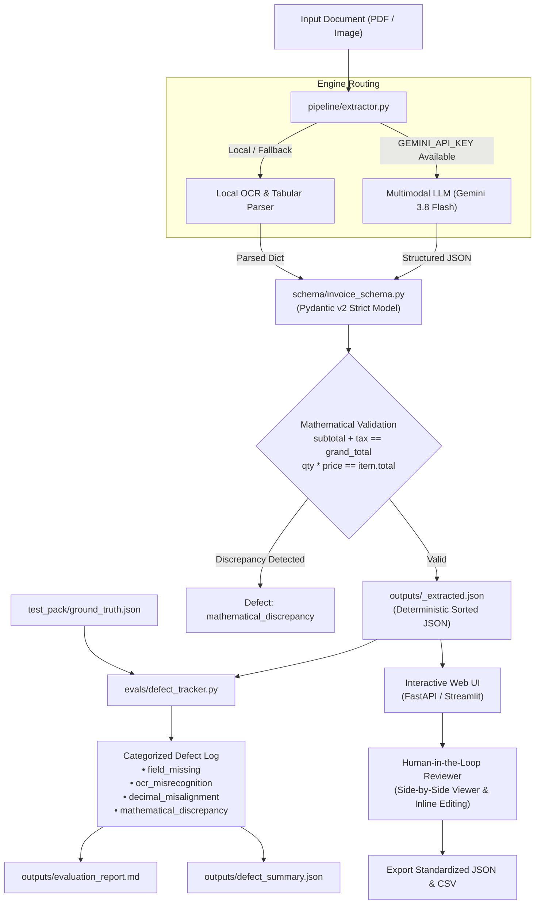

# Invoice Extraction Studio

A modular, enterprise-grade invoice extraction, evaluation, and human-in-the-loop review studio. Built with **Pydantic v2**, **Google Gemini multimodal vision models**, resilient fallback OCR, a four-tier **defect taxonomy tracker**, and an interactive **Side-by-Side Review Web UI** (FastAPI & Streamlit).

---

## Architecture Overview



---

## Directory Structure

```text
invoice-extraction-studio/
├── schema/
│   ├── __init__.py
│   └── invoice_schema.py           # Pydantic v2 strict models & mathematical validators
├── pipeline/
│   ├── __init__.py
│   └── extractor.py                # Multimodal vision LLM & fallback OCR pipeline with retries
├── evals/
│   ├── __init__.py
│   ├── defect_tracker.py           # Defect logging & 4-category classification engine
│   └── evaluate_test_pack.py       # Batch benchmarking runner for test_pack/
├── ui/
│   ├── __init__.py
│   ├── app.py                      # FastAPI Web Application & REST API
│   ├── streamlit_app.py            # Streamlit Interactive Dashboard
│   ├── confidence.py               # Dynamic confidence scoring & color badge engine
│   ├── exporter.py                 # Standardized JSON & CSV denormalized export
│   ├── static/
│   │   ├── style.css               # Visual indicators & responsive styles
│   │   └── app.js                  # Side-by-side zoom/pan & real-time recalculation
│   └── templates/
│       └── index.html              # Responsive human-in-the-loop review workbench
├── ui_assets/
│   ├── sample_export.csv           # Sample exported CSV with header & line items
│   └── validation_logs.json        # Test case verification and confidence log
├── test_pack/
│   ├── README.md                   # Detailed guide for the 8 test document fixtures
│   ├── ground_truth.json           # Master benchmark annotations
│   ├── doc_01_clean_digital_single_item.pdf
│   ├── doc_02_clean_digital_multi_item.pdf
│   ├── doc_03_photo_crumpled_receipt.png
│   ├── doc_04_photo_low_light_blurry.png
│   ├── doc_05_missing_tax_field.pdf
│   ├── doc_06_missing_dates_partial.pdf
│   ├── doc_07_complex_multi_page_table.pdf
│   └── doc_08_decimal_edge_case.png
├── outputs/
│   ├── sample_spec.md              # Input/output mapping specification
│   ├── sample_export.csv           # Sample exported reviewed CSV
│   ├── ui_validation_logs.json     # Validation test run logs
│   ├── defect_summary.json         # Aggregate evaluation metrics
│   ├── evaluation_report.md        # Comprehensive evaluation report (GitHub Flavored MD)
│   └── *_extracted.json            # Deterministic, validated JSON extractions
├── tests/
│   ├── __init__.py
│   ├── test_schema.py              # Pydantic v2 schema & validator tests
│   ├── test_defect_tracker.py      # Defect classification & reporting tests
│   ├── test_extractor.py           # Extraction pipeline & fallback tests
│   └── test_ui.py                  # Web UI endpoints & export tests
├── requirements.txt
└── README.md
```

---

## Web UI Features & Human-in-the-Loop Workbench

The studio includes two frontends (FastAPI SPA and Streamlit) fulfilling all requirements:

### 1. Side-by-Side Review Layout
- **Left Pane (Document Viewer)**:
  - High-resolution rendering of PDF pages (via `pypdfium2`) and raw image documents (PNG, JPG, WEBP).
  - Zoom in/out, fit to width, reset controls, and pop-out preview.
  - Dropdown selector to switch between all 8 benchmark test documents, or upload custom invoices.
- **Right Pane (Editable Form)**:
  - Form fields matching the Pydantic schema: `vendor_name`, `invoice_date`, `due_date`, `line_items`, `subtotal`, `tax_amount`, and `grand_total`.

### 2. Confidence Scoring & Visual Indicators
- Visual badges next to each field:
  - 🟢 **Green (>90%)**: High confidence, verified against known patterns and mathematical integrity.
  - 🟡 **Amber (70-90%)**: Moderate confidence, manual review recommended.
  - 🔴 **Red (<70% or Discrepancy)**: Low extraction confidence or triggered an arithmetic mismatch alert.
- Dynamic **Mathematical Discrepancy Banner**:
  - Highlights exact discrepancies (e.g., `qty * unit_price != total` or `subtotal + tax != grand_total`) with diff amounts and instant resolution tips.

### 3. Inline Editing & Real-Time Recalculation
- Reviewers can edit text, quantities, unit prices, and totals directly inside table rows.
- **Instant recalculation**:
  - Editing `qty` or `unit_price` updates the line item `total`.
  - Action button: `⚡ Recalc Products` updates all item totals.
  - Action button: `Apply Sum to Subtotal` sums all line items and updates subtotal & grand total.
  - As soon as the reviewer fixes numbers so arithmetic balances, the alert banner flips from 🔴 Red to 🟢 Green ("Arithmetic Verified").

### 4. Export Functionality
- **Download JSON**: Generates deterministic, alphabetically-sorted JSON adhering to the Pydantic model.
- **Download CSV**: Generates denormalized CSV combining invoice headers with itemized row records.
- **Save Reviewed**: Directly writes `{doc_stem}_reviewed.json` and `{doc_stem}_reviewed.csv` to `outputs/` and logs audit events to `ui_assets/validation_logs.json`.

---

## Quickstart & Launching the Web UI

### 1. Installation
```bash
pip install -r requirements.txt
```

### 2. Launch FastAPI Web Studio (Recommended)
```bash
uvicorn ui.app:app --reload --port 8000
# Or:
python -m ui.app
```
Open your browser to: **[http://localhost:8000](http://localhost:8000)**

### 3. Launch Streamlit Studio (Alternative)
```bash
streamlit run ui/streamlit_app.py
```
Open your browser to: **[http://localhost:8501](http://localhost:8501)**

---

## Running the Benchmark & Tests

### Benchmark Evaluation Suite
```bash
python -m evals.evaluate_test_pack local_ocr
```

### Pytest Verification Suite
```bash
pytest tests/ -v
# 22 passed (100% pass rate)
```
