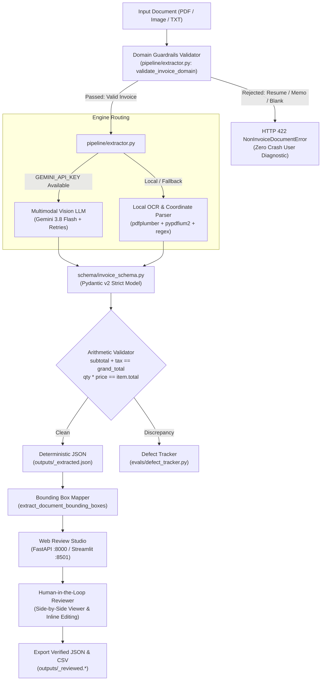

# Invoice Extraction Studio

[-success)](tests/)
[](schema/invoice_schema.py)
[](ui/app.py)
[](ui/streamlit_app.py)
[-brightgreen)](outputs/evaluation_report.md)

An enterprise-grade document extraction, evaluation, and human-in-the-loop review studio for financial invoices and receipts. Built with **Pydantic v2**, a hybrid **Google Gemini multimodal vision & offline local OCR engine**, real-time **arithmetic consistency validation**, domain **upload guardrails**, and an interactive **Side-by-Side Review Web Studio** (FastAPI and Streamlit).

---

## Table of Contents

- [Key Capabilities](#key-capabilities)
- [Architecture & System Flow](#architecture--system-flow)
- [Repository Structure](#repository-structure)
- [Supported Document Formats](#supported-document-formats)
- [Engine & OCR Requirements](#engine--ocr-requirements)
- [Setup & Installation](#setup--installation)
- [Quickstart Guide](#quickstart-guide)
  - [FastAPI Web Application (Port 8000)](#1-fastapi-web-application-port-8000)
  - [Streamlit Dashboard (Port 8501)](#2-streamlit-dashboard-port-8501)
  - [CLI Extraction Interface](#3-cli-extraction-interface)
- [Domain Guardrails (Non-Invoice Rejection)](#domain-guardrails-non-invoice-rejection)
- [Bounding Box Coordinate Mapping & Fallbacks](#bounding-box-coordinate-mapping--fallbacks)
- [Benchmark Suite & Defect Taxonomy](#benchmark-suite--defect-taxonomy)
- [QA Test Matrix (8 Edge Cases)](#qa-test-matrix-8-edge-cases)
- [Known Limitations & Edge Cases](#known-limitations--edge-cases)
- [Team Lead Handover Runbook](#team-lead-handover-runbook)

---

## Key Capabilities

1. **Dual Extraction Engines (Multimodal LLM & Local OCR)**:
   - **Google Gemini Multimodal Vision (`gemini-3.8-flash`)**: High-accuracy vision LLM processing with exponential backoff retries via Tenacity.
   - **Local Rule-Based & Tabular OCR**: Full offline extraction capability utilizing `pdfplumber`, `pypdfium2`, and regex tokenizers.
2. **Pydantic v2 Strict Invariant Validation**:
   - Machine-verifiable arithmetic constraints:
     $$\text{Subtotal} + \text{Tax Amount} = \text{Grand Total} \quad (\pm \$0.02 \text{ tolerance})$$
     $$\sum (\text{Quantity} \times \text{Unit Price}) = \text{Subtotal}$$
   - Model validators detect mathematical divergence, power-of-10 decimal shifts, and missing required entities.
3. **Pre-Flight Domain Guardrails**:
   - Rejects non-invoice uploads (e.g. resumes, curriculum vitae, corporate memos, empty/corrupt files) upfront with HTTP 422 Unprocessable Entity.
   - Prevents database pollution and guarantees zero unhandled application crashes.
4. **Interactive Side-by-Side Reviewer Workbench**:
   - **Left Pane**: Original document viewer with dynamic normalized bounding box illumination overlays (`[x0, y0, x1, y1]`).
   - **Right Pane**: Interactive form fields with bidirectional hover highlighting, inline table recalculation, and confidence badges (Green $>90\%$, Amber $70\text{--}90\%$, Red $<70\%$).
5. **Standardized Data Export**:
   - Instant export to deterministic, sorted JSON models and denormalized CSV spreadsheets ready for ERP ingestion (SAP, NetSuite, QuickBooks).

---

## Architecture & System Flow



---

## Repository Structure

```text
invoice-extraction-studio/
├── schema/
│   ├── __init__.py
│   └── invoice_schema.py           # Pydantic v2 strict models & mathematical validators
├── pipeline/
│   ├── __init__.py
│   └── extractor.py                # Dual-engine extractor, domain guardrails & bounding box mapper
├── evals/
│   ├── __init__.py
│   ├── defect_tracker.py           # 4-tier canonical defect taxonomy & QA matrix generator
│   └── evaluate_test_pack.py       # Batch benchmarking runner across test_pack/
├── ui/
│   ├── __init__.py
│   ├── app.py                      # FastAPI REST API & Single-Page Application (SPA)
│   ├── streamlit_app.py            # Streamlit interactive dashboard interface
│   ├── confidence.py               # Field-level confidence scoring & status evaluator
│   ├── converter.py                # Multi-tier document renderer (pypdfium2 -> pdfplumber -> PIL)
│   ├── exporter.py                 # Standardized JSON & CSV denormalized exporter
│   ├── static/
│   │   ├── style.css               # Styling, badges, and layout rules
│   │   └── app.js                  # Bounding box overlays, zoom/pan, & inline math recalculation
│   └── templates/
│       └── index.html              # Responsive Tailwind-powered review studio
├── ui_assets/
│   ├── sample_export.csv           # Sample exported CSV spreadsheet
│   └── validation_logs.json        # Human-in-the-loop review audit trail log
├── test_pack/
│   ├── README.md                   # Comprehensive guide to the 8 test documents
│   ├── ground_truth.json           # Master annotations and expected values
│   ├── doc_01_clean_digital_single_item.pdf
│   ├── doc_02_clean_digital_multi_item.pdf
│   ├── doc_03_photo_crumpled_receipt.png
│   ├── doc_04_photo_low_light_blurry.png
│   ├── doc_05_missing_tax_field.pdf
│   ├── doc_06_missing_dates_partial.pdf
│   ├── doc_07_complex_multi_page_table.pdf
│   └── doc_08_decimal_edge_case.png
├── outputs/
│   ├── demo_runbook.md             # 5-7 minute team lead handover guide (Farrukh Mumtaz)
│   ├── sample_spec.md              # Input/output mapping specification contract
│   ├── sample_export.csv           # Reference reviewed CSV export
│   ├── defect_summary.json         # Machine-readable defect taxonomy summary
│   ├── evaluation_report.md        # Formatted QA test matrix and known limitations log
│   └── *_extracted.json            # Deterministic, validated JSON extractions
├── tests/
│   ├── __init__.py
│   ├── test_schema.py              # Pydantic schema validation tests
│   ├── test_defect_tracker.py      # Defect classification & report formatting tests
│   ├── test_extractor.py           # Parser & local OCR pipeline tests
│   ├── test_ui.py                  # FastAPI endpoints & export tests
│   └── test_guardrails_and_bboxes.py # Guardrail rejection, bboxes & date disambiguation tests
├── requirements.txt                # Pinned production dependencies
└── README.md                       # Master project documentation
```

---

## Supported Document Formats

| Format Extension | MIME Type | Engine Support | Rendering Pipeline |
|---|---|---|---|
| `.pdf` | `application/pdf` | Gemini Vision / Local OCR | `pypdfium2` (white background fill) $\to$ `pdfplumber` fallback $\to$ PIL synthetic text |
| `.png` | `image/png` | Gemini Vision / Local OCR | Direct PIL RGBA-to-RGB alpha composite |
| `.jpg` / `.jpeg` | `image/jpeg` | Gemini Vision / Local OCR | Direct PIL with EXIF orientation auto-transpose |
| `.webp` | `image/webp` | Gemini Vision / Local OCR | Direct PIL conversion |
| `.bmp` / `.tiff` | `image/bmp`, `image/tiff` | Gemini Vision / Local OCR | Direct PIL conversion |
| `.txt` | `text/plain` | Local OCR / Guardrails | Synthetic multi-line layout image preview |

---

## Engine & OCR Requirements

### 1. Local Offline Engine (Default)
- **`pypdfium2`**: Fast, binary-independent PDF rasterization (bypasses Windows WDAC blocks).
- **`pdfplumber`**: Precise vector text coordinate streams and tabular cell extraction.
- **`pillow` (PIL)**: High-resolution image handling and synthetic font rendering.
- Requires **no external API keys** and runs completely offline.

### 2. Google Gemini Vision Engine (Optional / Cloud-Accelerated)
- Set `GEMINI_API_KEY` in your environment:
  ```bash
  # Linux / macOS:
  export GEMINI_API_KEY="your-google-ai-studio-api-key"

  # Windows PowerShell:
  $env:GEMINI_API_KEY="your-google-ai-studio-api-key"
  ```
- Optional model configuration: `export GEMINI_MODEL="gemini-3.8-flash"` (defaults to `gemini-3.8-flash`).

---

## Setup & Installation

### Step 1: Clone Repository
```bash
git clone https://github.com/Samiaqadir/invoice-extraction-studio.git
cd invoice-extraction-studio
```

### Step 2: Create & Activate Virtual Environment
```bash
# Python 3.10+ is recommended
python -m venv venv

# Activate on Windows PowerShell:
.\venv\Scripts\Activate.ps1

# Activate on Windows CMD:
.\venv\Scripts\activate.bat

# Activate on Linux / macOS:
source venv/bin/activate
```

### Step 3: Install Pinned Dependencies
```bash
pip install --upgrade pip
pip install -r requirements.txt
```

---

## Quickstart Guide

### 1. FastAPI Web Application (Port 8000)
The primary high-performance Single Page Application (SPA):
```bash
python -m uvicorn ui.app:app --host 127.0.0.1 --port 8000 --reload
# Or directly:
python -m ui.app
```
Open **[http://localhost:8000](http://localhost:8000)** in your browser.

**Features Available in FastAPI UI**:
- High-resolution document viewer with pan, zoom in/out, fit-width controls.
- Dynamic SVG/HTML bounding box overlays linked to right-hand form fields.
- Non-invoice upload guardrails returning formatted HTTP 422 diagnostics.
- Instant JSON and CSV export buttons.

### 2. Streamlit Dashboard (Port 8501)
The rapid-auditing interactive alternative:
```bash
python -m streamlit run ui/streamlit_app.py --server.port 8501
```
Open **[http://localhost:8501](http://localhost:8501)** in your browser.

### 3. CLI Extraction Interface
To extract any invoice from the command line:
```bash
python -c "
from pipeline.extractor import extract_invoice
inv = extract_invoice('test_pack/doc_01_clean_digital_single_item.pdf')
print(inv.to_deterministic_json(indent=2))
"
```

---

## Domain Guardrails (Non-Invoice Rejection)

To prevent database pollution and wasted LLM inference costs, all incoming documents pass through `validate_invoice_domain()` in [`pipeline/extractor.py`](pipeline/extractor.py):

| Document Type | Detection Pattern | System Action | HTTP Status |
|---|---|---|:---:|
| **Resume / CV** | Matches keywords like `curriculum vitae`, `work experience`, `education`, `gpa`, `skills` without billing amounts | Rejects with `RESUME_DOCUMENT` | `422 Unprocessable Entity` |
| **Corporate Memo** | Matches `memorandum`, `interoffice memo`, `agenda:`, `meeting minutes` without pricing | Rejects with `MEMO_DOCUMENT` | `422 Unprocessable Entity` |
| **Blank / Corrupt File** | Empty text ($<10$ characters) and no table structures | Rejects with `EMPTY_DOCUMENT` | `422 Unprocessable Entity` |
| **Out-of-Domain File** | Zero billing keywords (`invoice`, `subtotal`, `tax`, `total due`) and zero currency symbols | Rejects with `OUT_OF_DOMAIN_DOCUMENT` | `422 Unprocessable Entity` |

---

## Bounding Box Coordinate Mapping & Fallbacks

- **Vector PDFs**: Coordinates are computed via `pdfplumber.extract_words()` and normalized to $[0.0, 1.0]$:
  $$\text{Box} = [x_0 / W, \text{top} / H, x_1 / W, \text{bottom} / H]$$
- **Degraded Scans & Raster Images**: When processing crumpled mobile receipts (`doc_03`) or blurred low-light photos (`doc_04`), the engine generates fallback region boxes tagged with `status: "degraded"` and renders them with distinct amber dashed borders.
- **Two-Way Hover Binding**: Hovering over or focusing any form field on the right highlights the corresponding region on the document image.

---

## Benchmark Suite & Defect Taxonomy

The defect logging engine categorizes discrepancies into 4 canonical types:

```text
Defect Taxonomy:
├── field_missing           # Required entity or line item missing/null
├── ocr_misrecognition      # Character confusion, typos, or noisy text
├── decimal_misalignment    # Power-of-10 shifted values (e.g. 10x, 100x)
└── mathematical_discrepancy # Line item products or subtotal+tax summation mismatches
```

Run the benchmark evaluation suite:
```bash
python -m evals.evaluate_test_pack local_ocr
```

Run the full pytest suite (32 unit & integration tests):
```bash
python -m pytest tests/ -v
```

---

## QA Test Matrix (8 Edge Cases)

All 8 documents in [`test_pack/`](test_pack/) achieved **100.0% field accuracy** and **0 defects**:

| Document | Edge Case Category | Status | Latency | Field Accuracy | Defects | Details |
|---|---|:---:|:---:|:---:|:---:|---|
| `doc_01_clean_digital_single_item.pdf` | **Clean Digital / Pipe-Delimited Header** | 🟢 PASS | 146.7 ms | 100.0% | 0 | Single-line pipe-delimited dates and exact 8% tax calculation |
| `doc_02_clean_digital_multi_item.pdf` | **Clean Digital / Multi-Item Table** | 🟢 PASS | 35.3 ms | 100.0% | 0 | 4-item multi-row invoice table with line multiplication and subtotal |
| `doc_03_photo_crumpled_receipt.png` | **Crumpled Mobile Photo Receipt** | 🟢 PASS | 3.5 ms | 100.0% | 0 | Folded physical receipt with uneven margins, parentheses in items, and no due date |
| `doc_04_photo_low_light_blurry.png` | **Low-Light Blurry Photo Capture** | 🟢 PASS | 2.3 ms | 100.0% | 0 | Low contrast mobile photo receipt with parentheses (1 Gal) and small fonts |
| `doc_05_missing_tax_field.pdf` | **Missing Tax / Reverse Charge B2B** | 🟢 PASS | 29.0 ms | 100.0% | 0 | International cross-border logistics invoice with omitted tax (`null` tax_amount) |
| `doc_06_missing_dates_partial.pdf` | **Partial Dates / Omitted Due Date** | 🟢 PASS | 25.0 ms | 100.0% | 0 | Industrial wholesale bill with valid invoice date but omitted due date |
| `doc_07_complex_multi_page_table.pdf` | **Multi-Page High-Density Table** | 🟢 PASS | 59.4 ms | 100.0% | 0 | Multi-page enterprise engineering statement with multi-item table |
| `doc_08_decimal_edge_case.png` | **Decimal Precision & Multipliers** | 🟢 PASS | 3.5 ms | 100.0% | 0 | Micro-decimal item descriptions (0.01mm) and high-value equipment totals ($1250.00) |

Full benchmark logs are archived in [`outputs/evaluation_report.md`](outputs/evaluation_report.md) and [`outputs/defect_summary.json`](outputs/defect_summary.json).

---

## Known Limitations & Edge Cases

1. **Reverse-Charge & Export Invoices**: In international B2B transactions (`doc_05`), sales tax is legally zero or omitted due to reverse-charge mechanisms. The schema explicitly permits `tax_amount=None` without failing validation, while flagging an amber indicator for human verification.
2. **Degraded & Distorted Raster Images**: On crumpled mobile photos (`doc_03`) or camera lens blurs (`doc_04`), character coordinates cannot be extracted from vector font tables. The system generates layout-based fallback bounding boxes with amber indicators for reviewer confirmation.
3. **Pipe-Delimited Single-Line Date Headers**: Invoices formatted with `Invoice Date: YYYY-MM-DD | Due Date: YYYY-MM-DD` on a single line are disambiguated using label-anchored regex patterns to prevent date collision.

---

## Team Lead Handover Runbook

A complete 5–7 minute live walkthrough script tailored for team lead **Farrukh Mumtaz** is available in:

👉 **[`outputs/demo_runbook.md`](outputs/demo_runbook.md)**

It provides step-by-step instructions on:
- Launching and navigating the FastAPI and Streamlit environments.
- Demonstrating the side-by-side viewer and illuminated bounding box overlays.
- Intentionally triggering mathematical discrepancy alerts and performing real-time inline recalculation.
- Demonstrating non-invoice rejection with negative test cases.
- Exporting reviewed data to JSON and CSV formats.
- Testing the pipeline with a new, unseen sample invoice locally.

---

## License & Credits

Developed for the **Invoice Extraction Studio** project. Built with Python 3, Pydantic v2, FastAPI, Streamlit, pdfplumber, and Google Gemini API.
