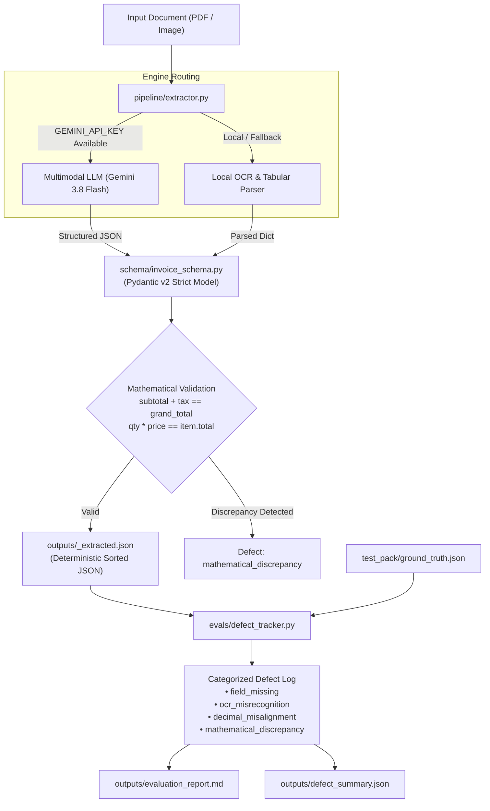

# Invoice Extraction Studio

A modular, enterprise-grade invoice extraction and evaluation engineering studio. Built with **Pydantic v2**, **Google Gemini multimodal vision models**, resilient fallback OCR, and a four-tier **defect taxonomy tracker**.

---

## Architecture Overview



---

## Directory Structure

```text
invoice-extraction-studio/
├── schema/
│   ├── __init__.py
│   └── invoice_schema.py           # Pydantic v2 strict models & mathematical validators
├── pipeline/
│   ├── __init__.py
│   └── extractor.py                # Multimodal vision LLM & fallback OCR pipeline with retries
├── evals/
│   ├── __init__.py
│   ├── defect_tracker.py           # Defect logging & 4-category classification engine
│   └── evaluate_test_pack.py       # Batch benchmarking runner for test_pack/
├── test_pack/
│   ├── README.md                   # Detailed guide for the 8 test document fixtures
│   ├── ground_truth.json           # Master benchmark annotations
│   ├── doc_01_clean_digital_single_item.pdf
│   ├── doc_02_clean_digital_multi_item.pdf
│   ├── doc_03_photo_crumpled_receipt.png
│   ├── doc_04_photo_low_light_blurry.png
│   ├── doc_05_missing_tax_field.pdf
│   ├── doc_06_missing_dates_partial.pdf
│   ├── doc_07_complex_multi_page_table.pdf
│   └── doc_08_decimal_edge_case.png
├── outputs/
│   ├── sample_spec.md              # Input/output mapping specification
│   ├── defect_summary.json         # Aggregate evaluation metrics
│   ├── evaluation_report.md        # Comprehensive evaluation report (GitHub Flavored MD)
│   └── *_extracted.json            # Deterministic, validated JSON extractions
├── tests/
│   ├── __init__.py
│   ├── test_schema.py              # Pydantic v2 schema & validator tests
│   ├── test_defect_tracker.py      # Defect classification & reporting tests
│   └── test_extractor.py           # Extraction pipeline & fallback tests
├── requirements.txt
└── README.md
```

---

## Key Modules & Implementations

### 1. `schema/invoice_schema.py`
- Implements strict Pydantic v2 data models: `LineItem` and `Invoice`.
- Fields: `vendor_name`, `invoice_date`, `due_date`, `line_items`, `subtotal`, `tax_amount`, and `grand_total`.
- Precision arithmetic via Python's `Decimal` with `ROUND_HALF_UP`.
- Model validators detecting mathematical discrepancies:
  - Header totals check: `subtotal + tax_amount == grand_total`
  - Line items sum check: `sum(item.total) == subtotal`
  - Per-item arithmetic: `quantity * unit_price == total`
- Provides `.to_deterministic_json(indent=2)` ensuring alphabetically sorted, reproducible JSON outputs.

### 2. `pipeline/extractor.py`
- Modular extraction engine with automatic engine routing (`auto`, `gemini`, or `local_ocr`).
- Multimodal Vision LLM support via `google-genai` with deterministic JSON response schema enforcement.
- Built-in retry mechanism using `tenacity` with exponential backoff on transient errors (rate limits, timeouts, 503).
- Robust local fallback leveraging `pdfplumber` and rule-based heuristics.
- Structured execution telemetry with latency tracking and discrepancy logging.

### 3. `evals/defect_tracker.py`
- Systematic defect logging classifying extraction errors into 4 canonical categories:
  - **`field_missing`**: Required or expected field/line item absent or empty.
  - **`ocr_misrecognition`**: Character confusion, spelling noise, or date format errors.
  - **`decimal_misalignment`**: Digits preserved but shifted by powers of 10 (e.g. 10x, 100x).
  - **`mathematical_discrepancy`**: Arithmetic inconsistency in line item products or subtotal/tax summations.
- Calculates document accuracy and field-level accuracy.
- Exports GitHub Flavored Markdown defect logs (`evaluation_report.md`) and machine-readable summaries (`defect_summary.json`).

---

## Quickstart & Usage

### 1. Installation
```bash
pip install -r requirements.txt
```

### 2. Extract a Single Invoice
```python
from pipeline.extractor import extract_invoice

# Extracts invoice and saves deterministic JSON to outputs/
invoice = extract_invoice("test_pack/doc_01_clean_digital_single_item.pdf", engine="auto")
print(f"Vendor: {invoice.vendor_name}, Total: ${invoice.grand_total}")
print(invoice.to_deterministic_json())
```

### 3. Run Benchmark Suite Across All 8 Test Documents
```bash
python -m evals.evaluate_test_pack local_ocr
```

### 4. Run Test Suite
```bash
pytest tests/ -v
```

